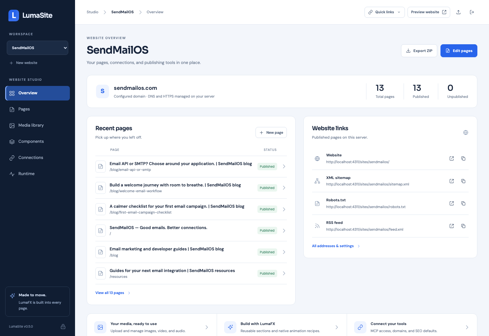
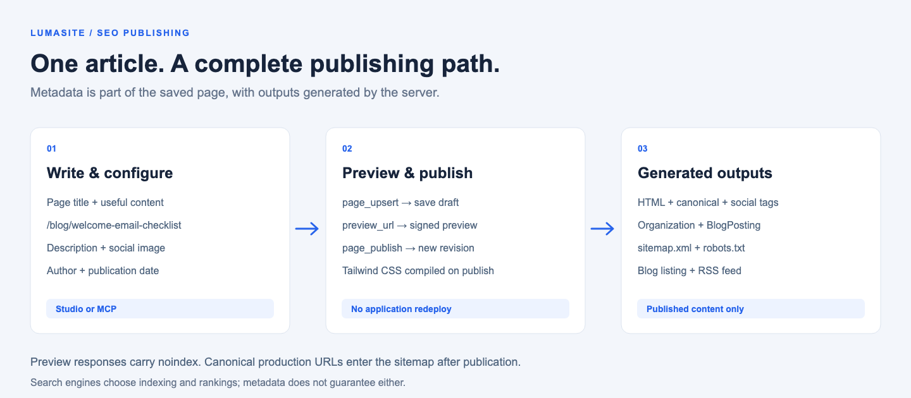

# LumaSite

**Your websites. Your server. Your workflow.**

A self-hosted website studio for creating, editing, and publishing through MCP or your browser. Change the page structure, HTML, Tailwind classes, CSS, browser JavaScript, images, and LumaFX animations, then publish a revision without redeploying the Studio application.

[](https://github.com/arrrrniii/lumasite/actions/workflows/ci.yml)
[Version 0.12.0](https://github.com/arrrrniii/lumasite/releases/tag/v0.12.0) · Node.js 24+ · Native LumaFX · Streamable HTTP MCP

## Install in one command

You need **Node.js 24 or later and npm**. No Git or GitHub account is needed for the standard registry installation:

```sh
npm create lumasite@latest
```

1. Name a new project folder, such as `my-website`.
2. Enter your production domain. **Server mode is the default**; the wizard suggests Studio/preview URLs, available ports, and a proxy choice.
3. Review the settings and confirm. Open the printed **Studio URL**, sign in with the generated password, and publish your first page.

```sh
cd my-website
npm run status
npm run health
```

For local laptop testing, run `npm create lumasite@latest -- --local` instead. Pin a release with `npm create lumasite@0.12.0`.

The wizard installs the application inside your project, generates private credentials and a website-scoped MCP URL, and writes a project README with your addresses and commands. A fresh installation starts with its own starter website. To bring an existing LumaSite website, select its exported ZIP during setup.

Server mode detects Apache/Caddy/Traefik and prepares proxy configuration. **DNS, HTTPS, enabling the proxy, and startup after reboot are server setup steps.** See [the illustrated wizard](docs/wizard-walkthrough.md) or [installation and upgrades](docs/install-from-github.md).

[Local answers](#start-with-the-wizard) · [Server example](#a-complete-server-example) · [SMTP and forms](docs/forms-and-email.md) · [Global layout](docs/global-layout.md) · [Analytics and tags](docs/integrations.md) · [SEO example](docs/seo-example.md) · [Operations](docs/operations.md)



*Actual Studio screenshot of the optional SendMailOS example. New installations start with their own data and a starter homepage draft.*

## What you can do

| Workflow | Included |
| --- | --- |
| Design and edit | Native HTML, Tailwind, CSS, browser JavaScript, and reusable sections |
| Share a layout | One published header/footer and shared CSS/JS, draft previews, history and MCP extraction |
| Add motion | Vendored LumaFX runtime and an animation recipe library |
| Manage websites | Multiple projects and domains; update an existing website from ZIP or delete it with confirmation |
| Work with agents | Website-scoped OAuth for ChatGPT, revocable app connections, and manual Bearer tokens |
| Publish carefully | Save drafts, open signed previews, publish revisions, restore previous versions |
| Prepare for search | Server-generated metadata, canonical URLs, JSON-LD, sitemap, robots.txt, and RSS |
| Collect submissions | Native contact/application forms, private inbox, SMTP notifications, retry and test controls |
| Connect website tools | Shared GA4, Tag Manager, Search Console verification and custom snippets; optional consent banner |
| Move to another server | Export a website ZIP and import it into another LumaSite installation |
| Recover website content | Private recovery ZIP saved before each update or deletion |
| Operate the runtime | Proxy detection, ports, status, health, diagnostics, logs, restart, stop, and backups |

Publishing compiles the page's Tailwind CSS and records a published revision. It does not run a new Studio application build or restart the server. Application code, dependencies, TypeScript, JSX, or bundler-specific imports still require the normal development and deployment workflow. LumaSite publishes browser-ready page code.

## Connect ChatGPT with OAuth

From **Connections**, copy the website’s MCP Server URL. In ChatGPT → Plugins → Add custom MCP server, paste it and choose **OAuth**. Sign in to your Studio and approve access to that website. Revoke access from **Connections → Connected apps**. Manual Bearer tokens remain available for compatible MCP clients.

[OAuth setup and troubleshooting](docs/oauth.md) covers discovery, Apache/Virtualmin exceptions, and upgrading an existing installation.

## Global header, footer, and code

Open **Global layout** to edit shared header/footer HTML, CSS, and JavaScript. Save and preview a draft, then publish once for every linked page. Page bodies and SEO stay independent. New pages inherit a published global layout; standalone pages remain supported.

Use `layout_get`, `layout_update`, `layout_publish`, and `layout_restore` through MCP. Existing sites can use `layout_extract` to inspect matching copies, then migrate them atomically with a recovery ZIP. It preserves unpublished page edits and page-specific code. [The layout guide](docs/global-layout.md) explains slots, versions, extraction, and ZIP transfers.

## Forms and email

Open **Forms & email** to create native contact/application forms and review private submissions. Configure your SMTP server, sender and fixed recipients in **SMTP settings**, then test the connection or send a test email. Submissions are saved before delivery and remain available if SMTP fails. Manage form definitions through MCP and add generated form HTML to any page. [Forms and SMTP guide](docs/forms-and-email.md).

Website ZIPs carry form definitions; private submissions and SMTP credentials stay on the destination server. Full private backups include the SQLite database and its encryption key.

## Website integrations

Open **Integrations** to configure Google Analytics, Tag Manager, Search Console verification, and custom snippets for every published page and blog post. Settings apply without republishing pages. Optional tags wait for a consent choice by default; previews and Studio receive none of these shared tags. Manage the same settings with `integrations_get` and `integrations_update`. See [the integration guide](docs/integrations.md).

## Update or delete an existing website

In Studio, open **Connections → Manage website**. Choose **Update from ZIP** to replace website content while preserving its name, domain, slug, project ID, and MCP credentials. The import dialog also supports creating a separate website. **Delete website** removes the selected website and disables its MCP connection. Both actions require typing its exact slug and save a private recovery ZIP first.

See the [update, delete, and recovery guide](docs/website-management.md) for the CLI, restoration steps, and production upgrade commands.

## Start with the wizard

Run the [installation command above](#install-in-one-command) from a real terminal. The first question is **What is your project named?** Choose a new folder such as `my-website`. The wizard then asks for a new website or ZIP import, website name/domain, ports, URLs, and whether to start the app. Server mode is assumed unless `--local` or `--mode local` is supplied. Server mode also asks about the reverse proxy. Review the summary before it writes the project.

For your first local website, run `npm create lumasite@latest -- --local`, then choose:

| Question | Example answer |
| --- | --- |
| Project folder | `my-website` |
| Import ZIP | Press Enter for a new website |
| Website name | `My Website` |
| Domain | Press Enter; connect one later |
| Admin/API/MCP port | `4310` |
| Website/media port | `4311` |
| Studio URL | `http://localhost:4310` |
| Preview URL | `http://localhost:4311` |
| Start, then create | `y`, then `y` |

The wizard selects available default ports; these numbers are examples. It does not stop another service to reuse its port.

```sh
cd my-website
npm run status
npm run health
npm run logs
```

Open the printed Studio URL, sign in with the generated password, and publish the starter homepage. Saving a draft alone does not make a new page public. The project is installed inside your folder and continues working after npx's temporary installer is removed.

### A complete server example


*Illustrated example using reserved `example.com` addresses. It shows the wizard's real question flow; credentials and project IDs are placeholders.*

Enter your domain, and give the Studio and public preview separate hostnames. LumaSite checks for **Apache, Caddy, and Traefik**, distinguishes installed/running services, inspects Docker proxy networking and ports 80/443, then suggests a proxy. You can override the suggestion. Ambiguous unattended setup requires an explicit choice.

LumaSite generates the application, private credentials, connection addresses, and Apache/Caddy/Traefik configuration. **You enable DNS, the proxy configuration, HTTPS, and startup after reboot through your server setup.** See [server detection and Traefik setup](docs/server-detection.md), including container backend addresses and existing TLS settings.

| Address in this example | Purpose | Private listener |
| --- | --- | --- |
| `https://example.com/` | Published website | `127.0.0.1:4311` |
| `https://preview.example.com/sites/my-website/` | Published preview | `127.0.0.1:4311` |
| `https://studio.example.com/admin` | Website Studio | `127.0.0.1:4310` |
| `https://studio.example.com/mcp/<project-id>` | Authenticated MCP endpoint | `127.0.0.1:4310` |

Read the [step-by-step wizard walkthrough](docs/wizard-walkthrough.md), including exact prompts, generated files, an Apache routing example, adding a second website, ZIP import, and troubleshooting. [Terminal installer reference](docs/terminal-installer.md) covers automation and all setup flags.

## Understand the project folder

```text
my-website/
  package.json          npm commands and a pinned LumaSite dependency
  package-lock.json     reproducible dependencies
  lumasite.mjs          local CLI launcher; remembers the data directory
  README.md
  .gitignore
  node_modules/         installed application and dependencies
  .lumasite/            private state, media, credentials, and deployment notes
```

Website data is separate from the application dependency. Preserve the data directory and use the same path on each command. Credentials, local state, media, logs, and website ZIPs do not belong in your application Git repository.

| Generated-project command | What it does |
| --- | --- |
| `npm start` | Start the native background runtime |
| `npm run status` | Show ports, URLs, process identity, and paths |
| `npm run health` | Check the listeners and readiness |
| `npm run doctor` | Diagnose the installation |
| `npm run detect` | Inspect the server's proxies, Docker networking, and ports 80/443 |
| `npm run logs` | Follow the server log; Ctrl+C leaves the viewer |
| `npm run restart` | Restart this verified installation |
| `npm stop` | Stop this verified installation |
| `npm run credentials` | Retrieve private saved credentials on your server |
| `npm run project:list` | List websites and their generated addresses |
| `npm run backup` | Save a private full-instance backup, including forms and SMTP encryption key |

Use your supervisor's lifecycle commands if Docker or systemd manages the process. Native `start` does not install a service that starts after reboot.

To upgrade the application later, follow [the generated-project upgrade steps](docs/website-management.md#upgrade-an-existing-generated-installation). Keep your data directory and existing credentials; first-time creation is for new installations. New v0.11.1 projects include the `backup` npm script; older projects can use `node lumasite.mjs backup`.

## Connect MCP and publish

Copy the endpoint from **Connections → MCP connection**, then configure that URL and its project Bearer token in a client that supports Streamable HTTP. Keep the token in the client's credential settings.

```text
Read the current project and pages
  → page_upsert: save an editable draft
  → preview_url: review the saved draft
  → page_publish: release a new published revision
```

Page saves do not replace the published revision. Updates should include the latest `pageId` and `revision` to detect conflicting edits. A signed preview lasts ten minutes; anyone holding it can view that saved draft until expiry.

The Studio's **Overview** lists recent pages and publication counts. **Quick links** and **Connections** expose the website, production domain, sitemap, robots.txt, RSS, Studio address, MCP endpoint, and private draft controls. See [the Studio guide](docs/studio.md).

## SEO and a blog, with real output



Page metadata and article HTML are served by the server. The built-in publication flow updates the sitemap, blog listing, and RSS without an application redeploy.

| Feature | How it works |
| --- | --- |
| Search title and description | Page settings override shared website defaults |
| Canonical URLs | Derived from the production domain and page path; optional override |
| Clean production navigation | Imported project-path links render as root paths on the configured domain; old paths redirect with 301 |
| Social sharing | Open Graph and Twitter card tags, image URLs, and image descriptions |
| Structured data | `Organization`, `WebSite`, `WebPage`, breadcrumbs, and article `BlogPosting` |
| Sitemap | Published, indexable canonical pages; revision-based `lastmod` and relative priorities |
| Preview indexing controls | Studio and preview responses carry noindex; sample pages can be noindex |
| Blog | Native article pages, automatic blog-list blocks, and related articles |
| RSS | Latest 100 indexable published articles |

Start with [the complete SEO example](docs/seo-example.md). It includes [input JSON](docs/examples/seo-input.json), [generated head tags and JSON-LD](docs/examples/seo-head.html), [sitemap XML](docs/examples/sitemap.xml), [robots.txt](docs/examples/robots.txt), and [RSS](docs/examples/feed.xml). The example is generated and checked against LumaSite's real publication code. Image URLs in it are illustrative; use your uploaded assets in a real project.

Set shared defaults in **Connections → SEO and branding**. Edit page and article fields in **Pages → Settings**, or use MCP. Page SEO changes need publication; shared project defaults apply immediately. The optional SendMailOS example contains a blog index and three noindex sample guides.

Technical SEO supports discovery and presentation. It does not guarantee indexing, rankings, or rich results. Google ignores sitemap `priority`; use the guide's production checks and Search Console workflow. [Google's sitemap guidance](https://developers.google.com/search/docs/crawling-indexing/sitemaps/build-sitemap) explains these limits.

## How it compares

| Starting point | Good fit | Main tradeoff |
| --- | --- | --- |
| **LumaSite** | Agent-authored marketing sites and blogs with editable page code, native MCP, and a shared Studio | Early product with a smaller feature set; you operate the server |
| **WordPress** | Publishing workflows, existing themes, and established plugins | Theme/plugin selection determines much of the editing and SEO workflow |
| **Next.js** | Custom React applications with application-specific rendering and data models | You assemble the CMS/editor, agent tools, and publication workflow |
| **Vite application** | A custom frontend and build pipeline | CMS, server rendering/prerendering, SEO automation, and authoring are separate choices |

This is a workflow comparison, not a ranking or performance benchmark. WordPress includes XML sitemaps; Next.js supports metadata, sitemaps, and content revalidation; Vite supports SSR integrations. Those features are not unique to LumaSite. See the [sourced comparison and SEO matrix](docs/comparison.md) for scope and tradeoffs, and the separate [pinned Sitewright review](docs/sitewright-comparison.md).

## Move a website with a ZIP

1. In the existing Studio, use **Connections → Export ZIP**.
2. On a new server, run the wizard and supply the ZIP path when asked, or use **Import ZIP** in an existing installation.
3. Choose the destination name/domain, then enable the server's DNS, HTTPS, and reverse proxy.
4. Verify published pages, metadata, sitemap, and media. Connect the newly generated MCP endpoint/token.

ZIPs include page source, drafts, published revisions, theme, SEO settings, global layout versions, integration settings, and media. Imports create a new project, remap internal assets, and generate a new project token. Administrator credentials are excluded. See [the production-transfer guide](docs/production-transfer.md).

For a generated project:

```sh
npm run export -- --project my-website --output /private/exports/my-website.zip
npm run import -- --file /private/imports/my-website.zip --slug another-website
```

## Other installation methods

A global CLI is optional:

```sh
npm install --global lumasite@0.12.0
lumasite setup
```

For development, clone the repository, run `npm ci`, then use `node bin/lumasite.mjs` as the CLI. [Install from GitHub](docs/install-from-github.md) covers a fresh server and upgrades. [Operations](docs/operations.md) covers Apache/Caddy/Traefik, Docker Compose, backups, and process management. Do not rerun first-time setup to upgrade an initialized instance.

The public npm packages are `lumasite` (runtime/CLI) and `create-lumasite` (initializer). GitHub holds their source, tests, documentation, and releases. The [npm publishing guide](docs/publishing-to-npm.md) covers maintainer releases. Website data, credentials, and project ZIPs remain private and excluded from these packages and this repository.

## Scope and verification

LumaSite is an independent application. The `marketing/` directory is the optional SendMailOS example; installing LumaSite does not install another person's live website or credentials. Local uploads store original images, audio, video, and WOFF2 files; no video transcoding service is included.

```sh
npm ci
npm test
npx playwright install chromium
npm run test:browser
npm run test:seo
npm run test:package
npm run test:projects
npm run test:oauth
node scripts/build-docs-assets.mjs
```

The runtime checks use temporary data and ports. Package checks install the actual distributable and verify that the generated project's runtime survives removal of its temporary installer. The documentation builder renders the diagrams and verifies example metadata, published-only sitemap/RSS, draft exclusion, noindex exclusion, and preservation of published SEO during draft edits. It never opens an existing instance's data. The Studio screenshot is a separately captured view of the included example.

Visuals, example inputs/outputs, and their generator live in the GitHub checkout. The runtime package keeps its existing allowlist. See [LumaFX integration](docs/lumafx-integration.md), [SEO and blog reference](docs/seo-and-blog.md), and [editing the marketing example](docs/edit-marketing-elements.md).
