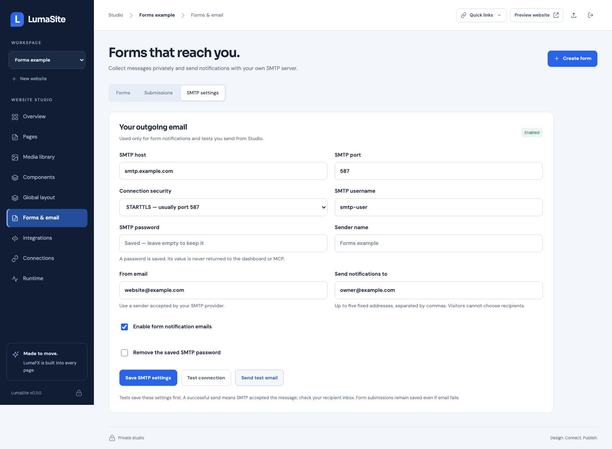

# Forms and SMTP notifications

LumaSite 0.11.0 adds native contact/application forms, a private submissions inbox, and project-specific SMTP settings. Open **Forms & email** in Studio. A submission is saved before email is queued, so SMTP failures do not discard the message.



## Configure your email server

Open **Forms & email → SMTP settings** and enter:

- SMTP host and port.
- Connection security: STARTTLS, commonly port 587, or TLS from connection start, commonly port 465. Custom ports are supported; choose the mode required by your provider.
- Username and password, if your server requires authentication.
- Sender name and **From email**, using a sender your provider accepts.
- **Send notifications to**: up to five fixed recipient addresses.

Choose **Save SMTP settings**. A blank password keeps the saved password; the removal checkbox explicitly clears it. **Test connection** saves the displayed settings, then checks the connection/authentication. **Send test email** saves the displayed settings and sends to those recipients, even if automatic notifications are disabled. Enable **form notification emails** when ready to receive new submissions. Saving settings alone sends no test email.

Transport uses certificate validation and requires TLS or STARTTLS. See [Nodemailer's SMTP options](https://nodemailer.com/smtp). A successful test means SMTP accepted the message; check the destination inbox and provider logs for downstream delivery. The visitor's email can be used as Reply-To; the From address and recipients come from Studio configuration.

The password is encrypted on the server and omitted from API/MCP responses. SMTP settings are private to this installation and website. They are separate from public page source and website ZIPs.

## Create and publish a form

1. Open **Forms → Create form**.
2. Name the form, edit fields and the success message, choose an email field for Reply-To, and enable submissions/notifications as needed.
3. Copy the form HTML or choose **Add to selected page**. Save and publish that page.
4. Submit on the configured production domain and check **Submissions** and the recipient inbox.

New forms start disabled. Supported field types are text, email, textarea, select, and checkbox, with required fields, maximum lengths, and select options. Up to 20 fields per form and 50 forms per website are supported. This version handles text fields; file attachments need a separate upload extension.

MCP can create/update definitions with `form_upsert`, inspect them with `forms_list`, and generate native HTML with `form_embed`. `smtp_status` reports configuration status without credentials. Private submission records and SMTP credential editing stay in authenticated Studio. Existing MCP clients may need to refresh their tool list after an upgrade.

```json
{
  "name": "Contact sales",
  "enabled": true,
  "notify": true,
  "replyToField": "email",
  "fields": [
    { "key": "name", "label": "Name", "type": "text", "required": true },
    { "key": "email", "label": "Work email", "type": "email", "required": true },
    { "key": "message", "label": "Message", "type": "textarea", "required": true, "maxLength": 5000 }
  ]
}
```

Use `formId` and `expectedRevision` when updating an existing form. Form settings apply immediately. When fields change, replace the embedded HTML on the page and publish it so browser fields match server validation. Form HTML is native and editable; keep the generated action, field names, `data-lumasite-form`, and status element. Basic styles and progressive JavaScript load automatically for projects with forms. Native form POST works without JavaScript too.

Submissions are accepted only on the exact production domain. Studio, signed previews, and project-path preview origins cannot send production notifications. The endpoint validates declared fields, required values, email addresses, select options, and size limits. Browser enhancement uses an idempotency key to avoid duplicate storage when retrying an unchanged request. A hidden honeypot and per-client/form rate limits provide basic spam controls: 10 new submissions per client/website per hour and 100 per form per hour. The rate limiter follows loopback proxies and the published [Cloudflare IPv4](https://www.cloudflare.com/ips-v4/) / [IPv6](https://www.cloudflare.com/ips-v6/) proxy ranges; it ignores forwarded headers from other direct peers. A single submission is limited to 20 KiB of validated field data.

## Inbox, delivery status, and retry

**Submissions** shows private saved records, fields, received time, review status, and SMTP status. Load older submissions using the pagination control. Mark records as read or archived without deleting them.

- **Queued / Sending**: waiting for or attempting SMTP delivery.
- **Accepted by SMTP**: the SMTP server accepted all configured recipients.
- **SMTP not configured / Notifications off**: the record is saved; review settings before retrying.
- **Needs attention**: automatic retries were exhausted. Fix settings and choose **Retry email**.

Failed sends retry up to five attempts with exponential backoff starting at 30 seconds, then require manual retry. Pending jobs survive restart; interrupted sends are reclaimed after a two-minute lease. Delivery is at least once: a disconnect after acceptance, or partial recipient acceptance, can result in duplicate notifications on retry. Stable Message-ID values help correlate attempts. Submissions remain saved independently of email delivery.

The From address and recipient list cannot be overridden by public form input. Reply-To uses the designated validated email field. Notifications contain the submitted text and record ID; custom HTML and filesystem/URL attachments are not accepted from visitors.

## Storage, transfer, and backups

Private records and encrypted SMTP settings are stored in `.lumasite/forms.sqlite`, using Node.js's built-in SQLite module. The encryption key is `.lumasite/smtp.key`. Both files are private server data. See [Node 24 SQLite documentation](https://nodejs.org/docs/latest-v24.x/api/sqlite.html) for the database/backup API used by the runtime.

Website ZIPs contain form definitions and page HTML, with IDs/action URLs remapped on import. They exclude submissions, SMTP settings/passwords, and the encryption key. Forms copied into a new website start disabled. An in-place ZIP update preserves destination private SMTP settings and existing submissions; records from replaced form IDs remain visible in the inbox, while notification retry requires a matching current form.

The CLI's full private **backup** includes a consistent SQLite snapshot and its encryption key. Use it to transfer or recover private form data. Keep the database/key together and stop the destination instance before restoring the full snapshot. Website deletion removes that project's private submissions and SMTP configuration as well as its public content; the website recovery ZIP alone cannot recover private records. Full backups retain their own private data until you remove them.

Authenticated Studio API routes include `/api/projects/:id/forms`, `/smtp`, and `/submissions`. Public form POSTs use `/forms/:projectId/:formId`, return only a receipt/success message, and expose no inbox or SMTP configuration.
