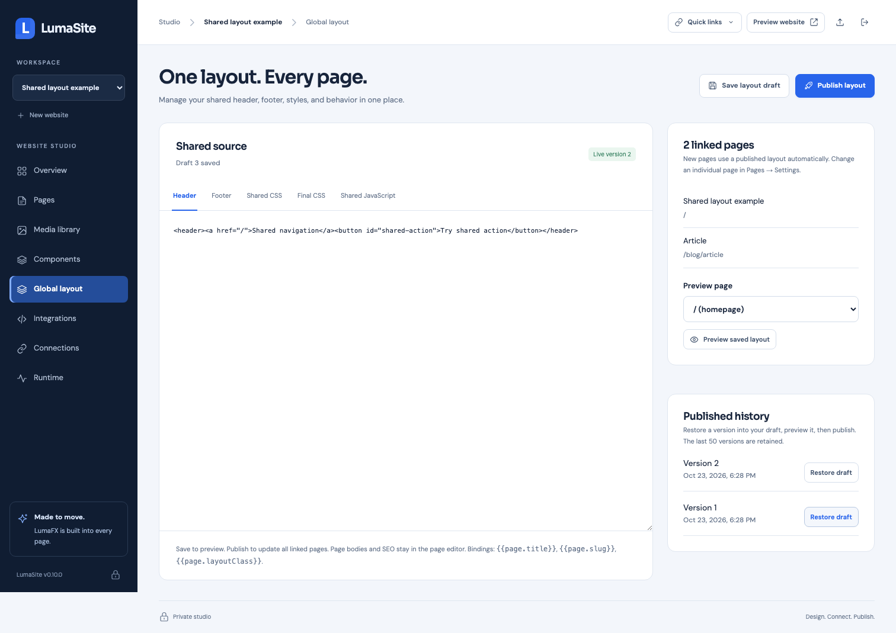

# One layout for many pages

LumaSite 0.10.0 adds an optional global layout per website: header HTML, footer HTML, shared CSS, optional final CSS, and shared browser JavaScript. Open **Global layout** in Studio. Save a draft, preview a linked page, and choose **Publish layout**. Every linked published page uses that version immediately. Page bodies, article content, SEO, and unpublished body changes remain separate.



No Studio application rebuild or restart is needed to publish a layout. Tailwind utilities found in shared markup and JavaScript are compiled at layout publication. Shared CSS and JavaScript use immutable, versioned asset URLs reused between pages. Old published layout assets remain available for the last 50 layout publications. Restoring history changes the draft; publish separately to make it live. Repeating publication of the same saved version has no effect.

## Page assignments and slots

A new page inherits a published global layout. Existing pages keep their current behavior until explicitly linked. In **Pages → Settings → Global layout**, choose **Global layout** or **Standalone page**, save, and publish the page. Remove embedded header/footer copies before linking, or use the extraction workflow below. Standalone pages keep their own HTML/CSS/JS.

Place these comment slots where the shared markup belongs:

```html
<div class="website">
  <!-- lumasite:header -->
  <main id="main"><h1>Page content</h1></main>
  <!-- lumasite:footer -->
</div>
```

Use exactly one of each slot, in that order. If neither slot is present, LumaSite prepends the header and appends the footer around the page HTML. Include mobile navigation dialogs in the shared header as needed. Full page wrappers remain in page source, allowing homepage and article layouts to differ.

Shared HTML supports escaped `{{page.title}}`, `{{page.slug}}`, and `{{page.layoutClass}}` bindings. For example, `<header class="site-header {{page.layoutClass}}">` uses the page's optional **Header variant class**. A homepage can set `home-header`; other pages leave it empty. These are text bindings, not a server-side code execution language.

CSS order is shared CSS, page CSS, then optional **Final CSS**. The final section preserves the cascade for existing sites that inserted article rules between common stylesheet sections. Leave it empty for layouts that do not need it. Shared JavaScript runs as a module before page JavaScript, after HTML parsing, once per full page load. Both can access the complete rendered DOM. Module-local variables are separate; expose an intentional browser API on `window` if they need to communicate.

Draft previews use the saved layout draft and page draft, with signed assets on the isolated website origin. Draft layout code is never executed in Studio and is not exposed through public layout asset URLs. Shared third-party analytics and verification settings remain in **Integrations**, with their production-only behavior.

## MCP and API

| Tool | Behavior |
| --- | --- |
| `layout_get` | Draft, current publication, history metadata, and page assignments |
| `layout_update` | Patch shared source; omitted fields stay unchanged |
| `layout_publish` | Publish the saved draft to all linked pages atomically |
| `layout_restore` | Restore a history snapshot into a draft |
| `layout_extract` | Inspect, then atomically extract matching existing copies |

Read before updating and pass `expectedRevision` from `layout_get` to detect another session's changes:

```json
{
  "expectedRevision": 1,
  "header": "<header class=\"site-header {{page.layoutClass}}\"><a href=\"/\">My website</a></header>",
  "footer": "<footer>Contact us</footer>",
  "css": ".site-header { padding: 24px; }"
}
```

Call `layout_publish` with the returned revision. Link individual drafts through `page_upsert` with `layoutMode: "global"` and optional `layoutClass`; then `page_publish`. Clients that cache the MCP tool catalogue may need to refresh it after upgrading.

Authenticated dashboard API endpoints:

```text
GET   /api/projects/:id/layout
PATCH /api/projects/:id/layout
POST  /api/projects/:id/layout/publish
POST  /api/projects/:id/layout/restore
POST  /api/projects/:id/layout/extract
```

Source fields are limited to 1 MiB each. Never include private API keys, MCP credentials, or administrator passwords in public layout source.

## Extract a layout from an existing website

Call `layout_extract` with `dryRun: true` first. Use page IDs from `pages_list`, including the source page. Selectors support a tag, `.class`, `#id`, `tag.class`, or `tag#id`; each must identify exactly one complete element per selected draft and published page.

```json
{
  "sourcePageId": "<page-uuid>",
  "pageIds": ["<page-uuid>", "<another-page-uuid>"],
  "headerSelector": "header.site-header",
  "footerSelector": "footer.site-footer",
  "additionalHeaderSelector": "dialog.mobile-menu",
  "variantClass": "home-header",
  "shareCss": true,
  "shareJs": true,
  "dryRun": true
}
```

The optional additional header element must immediately follow the header, apart from whitespace. `variantClass` permits the same header to differ by one class and records that class per page. Header and footer source must otherwise match exactly. JavaScript must match exactly to avoid splitting module-local variables between separate modules. CSS must share a prefix, or allow one complete shared prefix and final section around page-specific additions. Differing source is rejected; use `shareCss: false` or `shareJs: false` to retain those fields per page when necessary.

Review the returned page counts and shared byte counts. Repeat the same arguments with `dryRun: false` and `expectedFingerprint` set to the returned fingerprint. Extraction refuses stale plans, creates a private recovery ZIP, then atomically publishes the global layout and rewritten page snapshots. Existing unpublished body edits stay unpublished. Historical page versions remain available. Recovery ZIPs are downloadable through Studio's existing **Recovery ZIPs** control. A website with an existing layout cannot be extracted again.

## ZIP migration and application upgrades

Website ZIPs include the global layout draft, its current publication, history, and page assignments. Imports remap layout version IDs, media references, and internal navigation. Updating a website from ZIP replaces its layout with the archive's layout along with its page content; destination Integrations and credentials retain their existing preservation rules.

Upgrade the destination runtime to 0.10.0 or later before importing a ZIP containing global layouts. Older archives remain supported. Make a full private backup before upgrading or migrating live content. To roll back the application to a release without layout support, also restore a matching pre-layout data snapshot; old runtimes cannot render layout slots.

## Language variants and menus

From v0.13.0, layout_update accepts a locales map of translated header/footer overrides. Shared CSS/JS is reused, and Tailwind scans all overrides. Menu slots (`<!-- lumasite:menu:primary -->`), the language switcher (`<!-- lumasite:languages -->`) and `{{page.locale}}` render on the server. Every operation is available through MCP. See [languages and menus](languages-and-menus.md).
