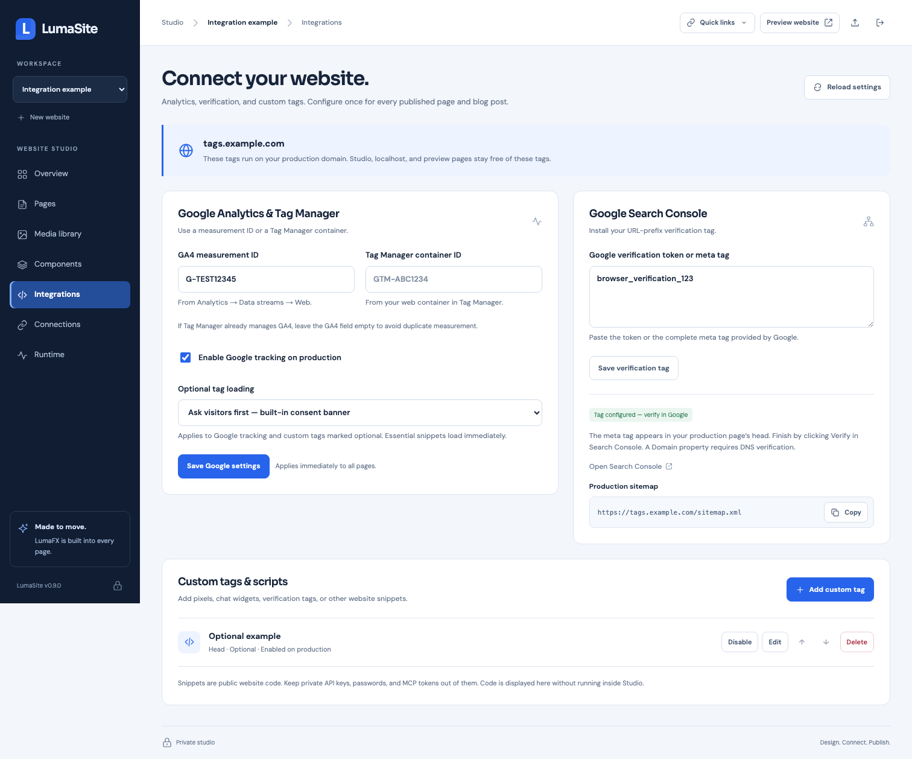

# Analytics, Search Console, and website snippets

Open a website in Studio → **Integrations**. These settings apply immediately to every published page, including existing and future blog posts. Saving them does not edit page source, republish revisions, or restart the application.



## Google Analytics and Tag Manager

Enter a GA4 measurement ID such as `G-ABC1234567`, or a web container ID such as `GTM-ABC1234`. Enable **Google tracking on production** and save. If Tag Manager already installs GA4, leave the separate GA4 field empty to avoid measuring twice.

This installs the website snippets; it does not create Google properties, authorize Google accounts, or display analytics reports in Studio. Confirm collection using Google's own testing tools. See [Google's installation guide](https://support.google.com/tagmanager/answer/15756615) and [Tag Manager web-container instructions](https://support.google.com/tagmanager/answer/14847097).

By default, optional tags wait for the built-in consent banner. No Google loader or optional custom snippet runs until the visitor accepts. A choice is stored in that browser for 180 days and applies across page navigation on the same origin. The **Privacy settings** button lets visitors change it. Rejecting after acceptance reloads the page so optional tags no longer load; this does not remove cookies already written by third parties or undo earlier requests. If browser storage is unavailable, the choice lasts for the current page.

Choose **Load immediately** only when you intend to load the tags immediately, for example when your own consent manager controls them. This bypasses LumaSite's banner. Essential custom head snippets run before the Google snippets so your manager can establish defaults. The banner is a basic tag-loading control, not a claim of legal compliance or a full consent-management platform. Advanced Google Consent Mode and region-specific policies require your own configuration; see [Google's consent guide](https://developers.google.com/tag-platform/security/guides/consent).

For a custom consent UI while using LumaSite's optional-tag loading:

```js
window.LumaSiteConsent.accept();
window.LumaSiteConsent.reject(); // reloads if optional scripts already started
window.LumaSiteConsent.settings();
window.addEventListener('lumasite:consent', event => {
  console.log(event.detail.choice); // accepted, rejected, or null
});
```

The API exists only when optional tags and the built-in banner are present. Essential snippets and code embedded directly in individual pages are outside this loading control. Do not mark analytics as essential merely to bypass the visitor's choice.

## Search Console

Paste the verification token or complete `<meta name="google-site-verification" content="…">` tag. Save, then open Search Console and choose **Verify** for the matching URL-prefix property. LumaSite places the token in the server-rendered production `<head>`.

**Tag configured** means the setting was saved; it does not mean Google has verified ownership. A Domain property requires DNS verification. The dashboard also includes the production sitemap URL to submit in Search Console. See [Google's ownership-verification instructions](https://support.google.com/webmasters/answer/9008080).

## Custom tags

Choose **Add custom tag**, give it a name, paste the complete HTML snippet, and select **Head**, **Start of body**, or **End of body**. Enable/disable, edit, reorder, or delete snippets from the list. A snippet marked optional follows the selected loading mode. Verification meta tags and essential site functionality can be marked essential to load without optional consent.

Use full `<script>…</script>` or `<script src="…"></script>` tags rather than bare JavaScript. Snippets are public website code. Never paste private API keys, OAuth secrets, administrator passwords, or MCP tokens. Studio displays code as text and does not execute it. Limits: 30 snippets, 64 KiB per snippet and 256 KiB total. Optional classic scripts without `async` load sequentially; `async` scripts retain asynchronous behavior. Complex snippets that depend on parser-time `document.write` should use the provider's supported dynamic-loading approach instead.

These integrations render only on the project's exact production hostname. Studio, signed previews, project-path previews, localhost, and reserved development domains do not receive them. Configure your domain and preserve Host in the reverse proxy. This exclusion covers shared integrations; author-controlled code already embedded in page HTML/JS remains as authored.

## Manage through MCP

1. Call `integrations_get` for the selected website.
2. Call `integrations_update` with the returned `revision` as `expectedRevision`.
3. Supply only fields to change. Omitted fields stay unchanged. `customTags` replaces the whole list, so retain entries you want to keep.

```json
{
  "expectedRevision": 0,
  "googleAnalyticsId": "G-ABC1234567",
  "trackingEnabled": true,
  "consentMode": "banner"
}
```

The API equivalent is authenticated `GET`/`PATCH /api/projects/<project-id>/integrations`. Both dashboard and MCP detect stale revisions with a conflict instead of overwriting another session's changes. Existing `website:manage` authorizations can manage these settings. Refresh the tool list in a connected client after upgrading if it caches the older catalogue.

## ZIP transfers and updates

Project ZIPs include integration configuration. Creating another website from a ZIP retains Google IDs and snippets for review but disables copied Google tracking and custom snippets, and clears the original Google verification token. Enable or replace the destination's IDs deliberately. Updating an existing website from ZIP preserves that destination's integration settings. Older ZIPs without integrations remain supported. Full private instance backups retain the active configuration unchanged.
