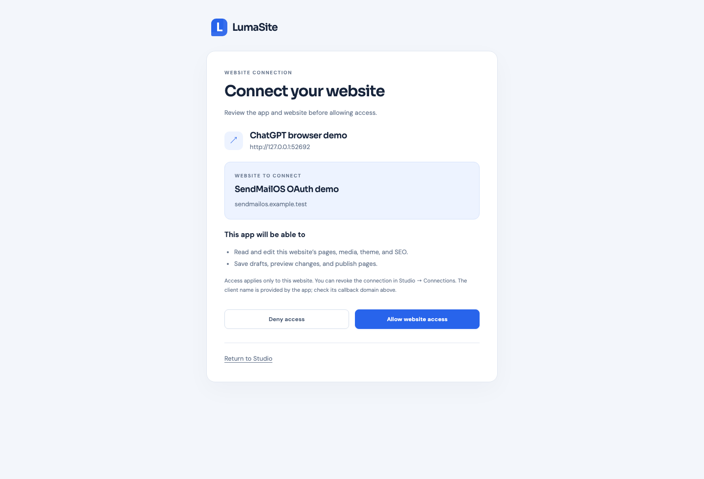

# Connect ChatGPT with OAuth

LumaSite 0.8.0 adds OAuth to each website’s existing MCP endpoint. Older releases only accept manual Bearer tokens, so choosing OAuth in ChatGPT produces “Couldn't discover OAuth settings.” Upgrading to 0.7.0 alone does not add OAuth.

## Connect a website

1. Upgrade the server to 0.9.0 or later and verify that the Studio URL uses HTTPS.
2. Open the intended website in Studio → **Connections** and copy its MCP Server URL, such as `https://studio.example.com/mcp/<project-id>`.
3. In ChatGPT → Plugins → Add custom MCP server, paste that URL and choose **OAuth**. Leave manual client credentials empty to use dynamic client registration.
4. Sign in to your LumaSite Studio when prompted. Check the app name, callback origin, website name and domain. Choose **Allow website access**.
5. Finish creating/installing the plugin in ChatGPT. The app can now use the website’s MCP tools.



*Local browser test with disposable example data. A real ChatGPT connection shows its registered callback domain.*

OAuth uses the Studio administrator login. The approved `website:manage` grant lets an app read and edit that website’s content, media, settings, and SEO, preview drafts, and publish pages. It grants no Studio administrator API or website deletion permission and cannot access another website. Every authorization requires explicit consent.

**Connections → Connected apps** shows active authorizations. **Revoke access** disables the connection’s access and refresh tokens immediately. Rotating the website’s manual project token also invalidates its OAuth grants. Deleting a website disables its grants; updating the same website from ZIP preserves them. Restoring a deleted website as a new project needs a new connection.

Manual project Bearer tokens still work in clients that support an Authorization header. They are separate from OAuth client credentials and should not be entered as a client ID or client secret in ChatGPT’s advanced OAuth settings.

## Discovery endpoints

All OAuth routes run on the **Studio/admin listener**, normally 4310:

| Route | Purpose |
| --- | --- |
| `/.well-known/oauth-authorization-server` | Authorization-server metadata |
| `/.well-known/oauth-protected-resource/mcp/<project-id>` | Exact website resource, issuer and scope |
| `/register` | Dynamic client registration |
| `/authorize` | PKCE authorization request |
| `/oauth/consent` | Studio login and explicit website consent |
| `/token` | Code exchange and refresh |
| `/revoke` | Token revocation |

Unauthenticated MCP requests return `401` with a `WWW-Authenticate` challenge pointing at that website’s protected-resource metadata. Resource and issuer values use the configured Studio URL. OAuth authorization and token requests must include the exact website MCP URL as their `resource`.

Authorization uses the MCP SDK’s registration, authorization, token and revocation handlers, S256 PKCE, exact callback binding, one-use two-minute authorization codes, session-bound consent and issuer identification (`iss`). Access tokens expire after one hour. Refresh tokens rotate on use and expire with the connection after 30 days; replay of a used refresh token revokes that connection. Clients then need to reconnect. Registration supports public clients (`none`) and confidential clients (`client_secret_post`). CIMD and client-credentials grants are not advertised.

## Apache and Virtualmin

A common Virtualmin configuration contains:

```apache
ProxyPass /.well-known !
ProxyPass / http://localhost:4310/
```

That broad exception sends OAuth discovery requests to the static document root, where they return 404. Inside **both HTTP and HTTPS VirtualHosts for the Studio domain**, put these narrow routes **before** the broad exception:

```apache
ProxyPreserveHost On
ProxyPass /.well-known/oauth-authorization-server http://127.0.0.1:4310/.well-known/oauth-authorization-server
ProxyPass /.well-known/oauth-protected-resource http://127.0.0.1:4310/.well-known/oauth-protected-resource
ProxyPass /.well-known !
ProxyPass / http://127.0.0.1:4310/
ProxyPassReverse / http://127.0.0.1:4310/
```

Keep existing TLS certificate settings. The narrow exceptions preserve local `/.well-known/acme-challenge/` handling. Use your configured admin port/upstream address if different. These routes belong to the Studio VirtualHosts, not the public website listener on 4311.

Back up the specific Apache file, then validate and reload:

```sh
apache2ctl configtest && systemctl reload apache2
```

Caddy and Traefik configurations generated by LumaSite already forward the Studio routes together. Any custom proxy must pass the discovery paths and the other OAuth endpoints to the same Studio instance.

Verify from outside the server:

```sh
curl -i https://studio.example.com/.well-known/oauth-authorization-server
curl -i https://studio.example.com/.well-known/oauth-protected-resource/mcp/PROJECT_ID
```

Both should return 200 with JSON. A 401 on `/mcp/PROJECT_ID` before login is expected; a 404 HTML page on discovery usually comes from the proxy. JSON 404 for a project resource means the project ID is wrong or the website was deleted. If an old OAuth client registration is lost, recreate/reconnect the custom MCP connection; keep `oauth.json` when upgrading.

## Upgrade an existing generated installation

```sh
cd /path/to/my-website
npm stop
node lumasite.mjs backup --output /private/backups/lumasite-before-0.9.0
npm install "lumasite@git+https://github.com/arrrrniii/lumasite.git#v0.9.0" --omit=dev --ignore-scripts
npm start
npm run health
```

The backup destination must be a new directory. Keep the data directory and use your existing supervisor for supervised deployments. Do not rerun first-time setup. For an existing Apache/Virtualmin installation, also apply the discovery routing above before retrying ChatGPT.

## Private storage and verification

`<data-dir>/oauth.json` stores OAuth client credentials and hashed authorization codes, access tokens, and refresh tokens with private file permissions. It is excluded from project ZIPs. Full-instance backups include this private file. Ephemeral consent requests expire after ten minutes and do not survive a restart; start linking again if a restart interrupts consent.

The automated checks cover discovery, registration, exact resource/client/callback binding, consent session and CSRF checks, replay, expiry, project isolation, token rotation, revocation, persistence, and credential exclusion from exports. `npm run test:oauth` runs a real MCP SDK client through browser login/consent, token exchange, tool calls, revocation, and mobile layouts. `npm run test:oauth-apache` is a local macOS Apache integration check reproducing the broad-exclusion 404 and verifying the narrow routes while preserving ACME handling. A full ChatGPT production connection still needs the deployed server and proxy to be updated.

See [OpenAI’s OAuth requirements](https://developers.openai.com/plugins/build/auth) and [custom MCP connection guide](https://developers.openai.com/api/docs/guides/custom-mcp-server).
