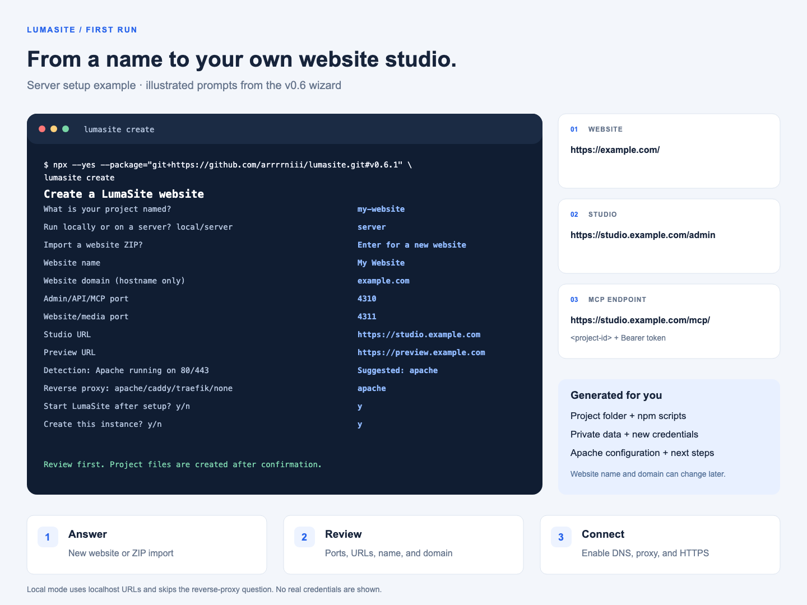

# From the wizard to a working website

The first-run creator makes an application folder, installs LumaSite, and prepares a website. This walkthrough matches v0.11.1's `create` command. The lower-level `setup` command also asks for a data directory; `create` uses `<project-folder>/.lumasite` by default, or an explicit `--data-dir`.



The image is an illustrated example of the real prompts, not output from a production deployment. `example.com`, the answers below, and `<project-id>` are placeholders. Generated credentials are deliberately absent.

## 1. Install prerequisites

Use Node.js 24 or later, npm, and Git. The repository is public; the HTTPS commands below do not require GitHub authentication. Updating npm does not update Node: check `node -v` and select Node 24+ before installing.

Start the creator from the parent directory where you want the new project:

```sh
npx --yes --package="git+https://github.com/arrrrniii/lumasite.git#v0.11.1" lumasite create
```

The outer `--yes` accepts npm's download prompt. It does not skip the creator's questions. The separate `create my-website --yes ...` form is for automation.

## 2. Answer the questions

This server example uses a new project folder and website called **My Website**:

| Actual prompt | Example answer | What it controls |
| --- | --- | --- |
| `What is your project named?` | `my-website` | New application directory; an existing directory is refused |
| `Run locally or on a server? local/server` | `server` | HTTPS origins and reverse-proxy setup for a server |
| `Import a website ZIP? Leave empty for a new website` | Press Enter | Create a new starter website instead of restoring an export |
| `Website name` | `My Website` | Name in Studio; defaults are used to derive the website slug |
| `Website domain (hostname only)` | `example.com` | Production hostname, with no scheme, path, or port |
| `Admin/API/MCP port` | `4310` | Private listener for authenticated administration and agent access |
| `Website/media port` | `4311` | Separate listener for public pages and media |
| `Studio URL` | `https://studio.example.com` | External administration origin; `/admin` is appended |
| `Preview URL` | `https://preview.example.com` | Public preview origin; project paths are appended |
| Server detection output | Apache running on 80/443 | Suggestion based on this server; reports installed/running proxies and Docker networking |
| `Reverse proxy: apache/caddy/traefik/none` | `apache` | Choose or override the detected configuration |
| `Start LumaSite after setup? y/n` | `y` | Start the native runtime after initialization |
| `Create this instance? y/n` | `y`, after reviewing the summary | Confirm the plan before project creation |

In **local** mode, leave the domain empty and accept the available `http://localhost:<port>` origins. The reverse-proxy question is skipped. Local testing does not require a public domain, Apache, or a certificate.

Server detection is read-only. It also recognizes Nginx for manual routing rather than proposing a competing proxy. If the chosen proxy runs in a bridged Docker network, the wizard asks for a backend address reachable from the container and an explicit listener bind. Traefik additionally asks for the existing HTTPS entrypoint and optionally an existing certificate resolver. See [detection details and Traefik examples](server-detection.md).

The defaults begin at 4310/4311 and move to available ports when necessary. Explicitly selecting an occupied port causes an error; the wizard does not stop that existing service. Replace all port numbers in your proxy configuration with the actual selected values.

## 3. Understand what is created

```text
my-website/
  package.json
  package-lock.json
  lumasite.mjs
  README.md
  .gitignore
  node_modules/lumasite/
  .lumasite/
    state.json                 private instance and website state
    credentials.json           private administrator and project credentials
    deployment/
      apache.conf              generated when Apache is selected
      server-detection.json    report when automatic detection ran
      NEXT-STEPS.txt            paths and matching operational commands
```

Media and runtime files appear in the data directory as they are used. A custom `--data-dir` can live outside the application folder. Keep it persistent across application updates.

For the example above, the creator prepares:

| Resource | Generated address |
| --- | --- |
| Studio | `https://studio.example.com/admin` |
| Website workspace | `https://studio.example.com/admin/projects/<project-id>` |
| MCP endpoint | `https://studio.example.com/mcp/<project-id>` |
| Published preview | `https://preview.example.com/sites/my-website/` |
| Production website | `https://example.com/` |
| Production sitemap | `https://example.com/sitemap.xml` |
| Production robots | `https://example.com/robots.txt` |
| Production RSS | `https://example.com/feed.xml` |

The UUID replaces `<project-id>` automatically. Studio/API access requires your administrator session or appropriate credentials. MCP uses a project-scoped Bearer token with Streamable HTTP. Save credentials privately; they are not part of an example screenshot or a website ZIP.

## 4. Connect Apache, DNS, and HTTPS

The wizard generates proxy configuration and next-step notes. Saving a domain does not point it to your server. Activate these routes using your existing server configuration:

| Browser hostname | Apache upstream in this example | LumaSite behavior |
| --- | --- | --- |
| `studio.example.com` | `http://127.0.0.1:4310` | Admin, API, and MCP |
| `preview.example.com` | `http://127.0.0.1:4311` | `/sites/<slug>/` published previews and signed draft previews |
| `example.com` | `http://127.0.0.1:4311` | Root-path website chosen by its hostname |

Point the required DNS records at your server, review `.lumasite/deployment/apache.conf`, enable the required proxy modules and virtual hosts, and configure valid HTTPS certificates. Preserve the incoming Host header for public website routing. Keep Studio on a separate administration origin. The generated file is reviewed configuration text; the wizard does not alter your existing Apache sites or issue certificates.

Use [the Apache/Caddy/Traefik operations guide](operations.md) for configuration commands. Caddy generates `Caddyfile`; Traefik generates `traefik-dynamic.yml` for its existing file provider. Configure a supervisor for startup after reboot. Native `npm start` runs in the background but does not install a boot service.

## 5. Publish and connect MCP

```sh
cd my-website
npm run health
npm run status
```

Open the Studio, sign in, and select the project. A new homepage starts as a draft: edit it, inspect the draft preview, and use **Publish page**. The published website is then available at its preview path and, once routing is enabled, its production domain.

In **Connections**, copy the MCP endpoint and configure its project token in a compatible client's authorization settings. Typical agent flow: `page_get` or `pages_list` → `page_upsert` → `preview_url` → `page_publish`. Keep the latest revision when updating an existing page.

## 6. Add another website on the same server

Use **New website** in the same Studio, or run from the generated project folder:

```sh
node lumasite.mjs project create --name "Second Website" --domain second.example.com
```

It creates a new website, pages, and MCP credential within the existing installation. You continue using the same two listeners. Point `second.example.com` to the server and add its Apache virtual host to the public listener with the Host header preserved. LumaSite chooses the project from the domain. The existing Studio hostname manages both websites.

Do not rerun the first-time wizard to add websites to an initialized instance. A separate installation is useful when you deliberately need separate data, credentials, or process management; it needs its own free ports.

## 7. Import an existing website instead

Export a ZIP from **Connections → Export ZIP**. When the creator asks for a ZIP, enter its path. You can keep the exported website name or choose a new one and enter the intended destination domain. In server mode, the import uses production-domain links; local mode uses project-path links.

Published pages, drafts, revisions, SEO settings, theme, and media are restored. LumaSite remaps internal assets and generates a new MCP token. It does not transfer the source installation's administrator password or automatically change DNS. Existing installations can use the Studio's **Import ZIP** action. See [production transfer](production-transfer.md).

## Day-to-day commands

Run these in the generated project folder:

| Command | Use |
| --- | --- |
| `npm start` | Start and wait for readiness |
| `npm run status` | Locate ports, URLs, data, log, and process |
| `npm run health` | Check that both listeners are working |
| `npm run doctor` | Diagnose configuration and process ownership |
| `npm run detect` | Inspect existing proxies, Docker, and ports 80/443 |
| `npm run logs` | Follow logs; Ctrl+C exits the log viewer |
| `npm run restart` | Restart this managed instance |
| `npm stop` | Stop this managed instance |
| `npm run credentials` | Retrieve saved credentials privately |
| `npm run project:list` | List this instance's websites |
| `npm run backup` | Save a private full-instance snapshot (projects created with v0.11.1+) |

When a supervisor owns the process, use that supervisor's stop/start/restart commands. Do not run setup again to update the application; use the [upgrade workflow](install-from-github.md#update-the-application).

## If setup needs attention

| Symptom | Check or next step |
| --- | --- |
| GitHub fetch fails | The repository is public; test `GIT_TERMINAL_PROMPT=0 git ls-remote https://github.com/arrrrniii/lumasite.git HEAD` and inspect network access or Git URL rewrites |
| Project directory exists | Choose a new folder; `create` will not overwrite it |
| Data directory is initialized | Use the existing instance's commands, New website, or Import ZIP |
| A port is busy | Choose two free ports; inspect existing services before changing them |
| Local health passes but the domain fails | Check DNS, certificates, Apache/Caddy/Traefik upstreams, and Host preservation |
| Studio opens but the new website returns 404 | Publish its homepage; confirm the hostname or `/sites/<slug>/` path |
| Installation was interrupted | In the retained new project folder, run `npm install`, then `npm run setup`; initialized data is not reset |

The exact available flags and noninteractive examples are in [the terminal installer reference](terminal-installer.md).
